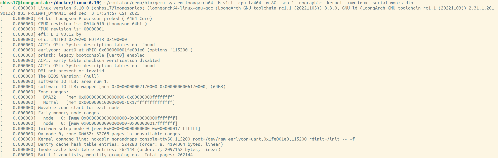
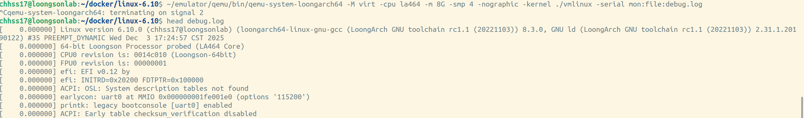
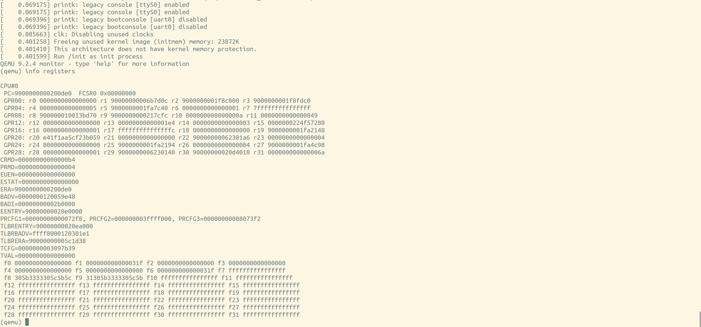
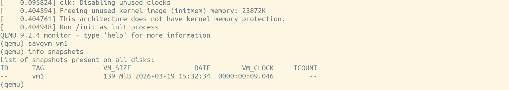
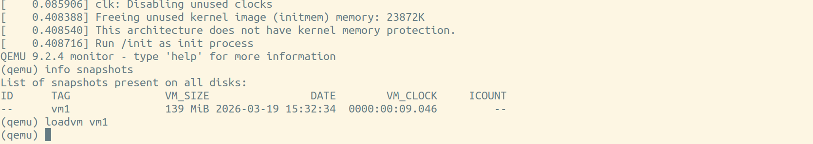
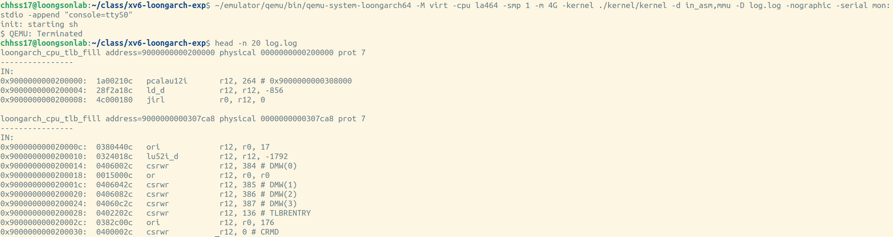

# LoongArch最小debug环境搭建

## 制作 Linux RamDisk

请参考文档第一章，安装 QEMU 。

请参考文档第一章，编译 Linux Kernel 。

使用以下命令，在 QEMU 中启动 Linux Kernel。
``` bash
#	replace your real path with {/path/to/qemu}.
{/path/to/qemu}/bin/qemu-system-loongarch64 -M virt -cpu la464 -m 8G -smp 1 -nographic -kernel ./vmlinux -serial mon:stdio
```
运行结果如下所示:


## QEMU 参数说明

QEMU 常用的启动参数，如下所示:

1. 设备类型: -machine/-M

在qemu中，不同的指令集的模拟器会编译成不同的可执行文件，可以运行在不同的平台上，可使用 -machine/-M 指定模拟器运行的设备信息。
```shell
$ qemu -M ?

Supported machines are:
none                 empty machine
virt                 Loongson-3A5000 LS7A1000 machine (default)

```
2. 内存大小: -m

参数-m 1G就是指定虚拟机内部的内存大小为1GB，使用说明如下:

```shell
$ qemu -m ?

qemu-system-loongarch64: -m ?: Parameter 'size' expects a non-negative number below 2^64
Optional suffix k, M, G, T, P or E means kilo-, mega-, giga-, tera-, peta-
and exabytes, respectively.
```

3. 核心数: -smp

现代cpu往往是对称多核心的，因此通过添加启动参数 -smp 8 可以指定虚拟机核心数为 8。

```shell
$ qemu -smp ?

smp-opts options:
  books=<num>
  clusters=<num>
  cores=<num>
  cpus=<num>
  dies=<num>
  drawers=<num>
  maxcpus=<num>
  sockets=<num>
  threads=<num>
```

4. 关闭图像输出: -nographic

参数关闭了图像输出模式，QEMU 运行时不再弹出新窗口，信息输入输出，通过 serial 串口，在终端显示交互。

5. 串口输出重定向: -serial

-serial 选项用于配置 QEMU 中虚拟机的串行端口（UART），将串行端口重定向到宿主机指定的字符设备（char dev），如标准输入/输出（终端）、TCP端口、文件等。

该参数决定了虚拟机串口的数据“从哪里来，到哪里去”，在调试嵌入式系统和操作系统启动过程中非常有用。

-serial 的基本用法是 -serial dev，其中的 dev 代表你要重定向到的目标设备。

在启动 Linux 时，常见用法为 -serial mon:stdio。该选项表示将 QEMU 的监视器（monitor）和虚拟机串口复用，一起重定位到QEMU进程的标准输入输出(终端)。

6. 调试参数: -s、-S 与 `-gdb`

这些参数用于建立 GDB stub 服务。`-s` 是 `-gdb tcp::1234` 的简写；为避免将未经
认证的调试端口暴露到局域网，日常调试应显式绑定回环地址，而不是依赖 `-s`：

```bash
-S -gdb tcp:127.0.0.1:1234
```

`-S` 会使 QEMU 在启动后保持 guest CPU 停止，直至 GDB 连接后执行 `continue`/`c`。
GDB stub 没有认证或加密；不要监听 `0.0.0.0`、不要把该端口做端口转发，也不要连接不可信
网络中的 stub。远程协作应使用受访问控制的 SSH 隧道，并明确谁可以读写 guest 内存和寄存器。

7. 指定镜像: -kernel

熟悉上述参数后，可在 QEMU 时添加对应参数，进入调试模式。

首先需要在启动 Linux Kernel 时加入额外参数。

参数指定传入 QEMU 的内核的镜像文件，一般是ELF文化，也可以是uImage等。

``` bash
#	replace your real path with {/path/to/qemu}.
{/path/to/qemu}/bin/qemu-system-loongarch64 -M virt -cpu la464 -m 4G -smp 1 -nographic -kernel ./vmlinux -serial mon:stdio -S -gdb tcp:127.0.0.1:1234 -pidfile qemu.pid
```

打开一个新终端，并在终端中运行以下命令:

``` bash
gdb ./vmlinux
```

进入 gdb 程序后，使用以下命令，与 QEMU 进行连接。
``` bash
(gdb)target remote 127.0.0.1:1234
```

:::{note}
端口 1234 是 `-s` 的默认 GDB 端口。端口不可用时，可使用
`-gdb tcp:127.0.0.1:xxxx` 替代 `-s`，其中 `xxxx` 是未占用的本地端口。

同时，在 GDB 中使用 `target remote 127.0.0.1:xxxx` 连接；端口必须与 QEMU 启动参数一致。
:::

### 会话结束与清理

建议为每次调试建立独立的工作目录，并使用 `-pidfile qemu.pid` 记录 QEMU PID。结束时先在
Monitor 输入 `quit`，或向确认无误的 PID 发送 `SIGTERM`；然后确认监听端口、PID 文件和日志
已清理。GDB 侧先执行 `detach`（如需继续运行 guest）或直接结束远程会话；`quit` GDB 不会自动
清理独立运行的 QEMU。若 QEMU 因 `-S` 或断点保持停止，须显式 `continue` 或在 Monitor `quit`，
否则会留下看似“卡住”的调试实例。

```bash
ss -ltnp '( sport = :1234 )'
test -f qemu.pid && ps -p "$(cat qemu.pid)" -o pid=,cmd=
```

## QEMU 调试教程

### 串口输出重定向

通过 -serial 参数，将虚拟机的调试信息，通过串口进行输出，并在宿主机上重定向到指定设备。

可使用 -serial mon:stdio 到当前终端。

也可将调试信息保存到指定文件。

可通过如下命令:

``` bash
# replace your real path with {/path/to/qemu}.
# replace your filename with 'debug.log'
{/path/to/qemu}/bin/qemu-system-loongarch64 -M virt -cpu la464 -m 8G -smp 1 -nographic -kernel ./vmlinux -serial mon:file:debug.log
```

在当前文件下，会生成 debug.log 文件(或指定名字的文件)。查看文件，可得到调试信息(查看调试信息文件之前，需要通过 Ctrl + C 结束 QEMU 进程)。

运行结果如下所示:


### GDB 调试

可查看文档 8.2 章 -- GDB 使用

### QEMU Monitor

QEMU内部有一个管理控制台，提供了一套命令来动态查询和修改虚拟机状态，而无需重启虚拟机。Monitor
同样拥有控制 guest 的能力；本章仅使用本地 `stdio`，不要把 HMP/QMP monitor 以未认证 TCP
服务暴露给网络。

默认情况下，可以通过 Ctrl+Alt+2 组合键在图形界面中切换到Monitor。在无图形界面中，可通过 -monitor stdio 将其重定向到当前终端，也可以与串口复用：-serial mon:stdio，此时可通过特定转义键（如Ctrl+a c）在串口和Monitor之间切换。

在 Monitor 状态下，可以使用一些命令，查看虚拟机状态，进行调试。

调试类命令，与 GDB 模式相同。如可使用 info 命令查询虚拟机状态信息，运行如下所示:



控制类命令，则支持 qemu 的快照功能。

QEMU 的快照功能是将虚拟机在某个时间点上的磁盘与运行状态保存，以便在需要时恢复。快照适合可重复
实验，不是备份方案：`savevm`/`loadvm` 的可用性取决于块设备和镜像格式，恢复也会丢弃快照之后的
guest 状态。只对可丢弃的 qcow2 副本操作，保留原始镜像只读备份；不要在包含敏感数据的镜像上把
快照或 overlay 交给不受信任的用户。

保存快照时，首先使用以下命令，创建一个 qcow2 格式的磁盘镜像(raw格式不支持快照):
``` bash
# replace your real path with {/path/to/qemu}.
{/path/to/qemu}/bin/qemu-img create -f qcow2 save.qcow2 10G
```
系统启动参数，修改为如下命令:
``` bash
# replace your real path with {/path/to/qemu}.
{/path/to/qemu}/bin/qemu-system-loongarch64 -M virt -cpu la464 -m 8G -smp 1 -nographic -kernel ./vmlinux -serial mon:stdio -drive file=save.qcow2,format=qcow2
```
退出 QEMU 前可在 Monitor 使用 `info snapshots` 确认快照名称；不再需要的实验镜像应在确认路径后
单独删除。若使用 `-snapshot`，写入会进入临时 overlay 并在 QEMU 正常退出时丢弃，它同样不是
持久快照或崩溃恢复机制。

运行结果如下所示:



加载快照，可使用以下命令，运行结果如下所示:



### 日志工具

QEMU 中使用 -d 和 -D 参数配合使用是调试操作系统非常有效的方法，可以记录详细的内部调试信息，帮助开发者分析操作系统的行为、定位问题。日志可能包含 guest 内存内容、地址、命令行或文件路径，
应视为调试数据，避免上传到公共位置。

-d 参数用于启用调试信息的打印，后面可以跟一个或多个调试信息类型，用逗号分隔。

常见调试信息类型包括：
- in_asm：记录汇编指令执行
- exec：记录指令执行
- int：记录中断信息
- mmu：记录内存管理单元(MMU)操作
- cpu：记录CPU操作
- mem：记录内存访问

-D 参数用于指定调试日志文件的路径，将调试信息输出到指定文件中，而不是显示在终端上。`in_asm`、
`exec`、`cpu` 等选项会高速增长日志；将其写入专用目录，限制运行时间并监控剩余磁盘空间。调试结束后
确认不再需要的日志已按项目的数据保留规则清理。

在编译小型操作系统时，两个参数可配合使用，运行结果如下所示:



可以获取内核完全启动前的信息，方便调试。

### 常见问题

1. GDB 无法连接 QEMU

检查 QEMU 是否使用了 -S 和 -gdb 参数；确保端口未被占用。

2. 内核启动信息不显示

确认使用了-nographic和-serial mon:stdio参数；检查内核参数中是否设置了console=ttyS0；检查 QEMU 配置内存大小是否满足操作系统要求；检查操作系统串口基址是否和 QEMU 设备匹配。

3. GDB无法加载调试符号

确保编译内核时启用了CONFIG_DEBUG_INFO。

4. QEMU 启动失败

常见检查顺序：[检查启动命令] --> [路径是否正确] --> [内存/CPU是否合理] --> [镜像文件是否损坏] --> [资源是否超限] --> [使用qemu-img修复] --> [调整资源配置] --> [检查系统环境] --> [KVM是否加载] --> [权限是否足够] --> [modprobe kvm] --> [使用sudo执行] --> [启用调试日志]
